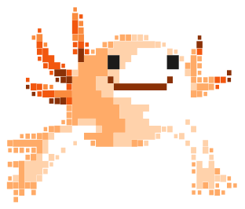
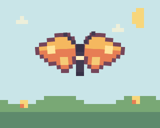
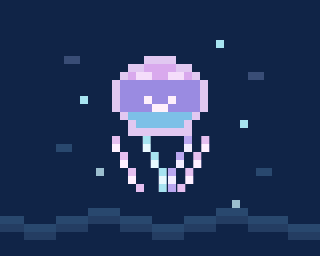

# Source Artwork Skills

Portable, provider-agnostic agent skills for inspecting real artwork and recreating its 2D animation and 3D form faithfully.

## Skills

- **[Source Artwork 2D/3D Reconstruction](skills/source-artwork-2d-3d-reconstruction/SKILL.md)** — unified workflow; use this for end-to-end, source-faithful 2D and 3D work.
- [Source Artwork 2D Animation](skills/source-artwork-2d-animation/SKILL.md) — focused pixel-art, SVG, sprite-frame, and playback workflow.
- [Source Artwork 3D Animation](skills/source-artwork-3d-animation/SKILL.md) — focused source-derived 3D geometry, rigging, and looping animation workflow.
- [Source Artwork Fidelity Battery](skills/source-artwork-fidelity-battery/SKILL.md) — standalone quantitative audit with explicit comparison modes, tolerances, and a reusable proof packet.

## Worked example: 2D and 3D axolotl animations

<table>
  <tr>
    <th>2D animation (source-cell rig)</th>
    <th>3D reconstruction (animated)</th>
  </tr>
  <tr>
    <td>
      <picture>
        <source srcset="examples/axolotl-2d-source.svg" media="(prefers-reduced-motion: reduce)">
        
      </picture>
    </td>
    <td>
      <picture>
        <source srcset="examples/axolotl-3d-demo-still.png" media="(prefers-reduced-motion: reduce)">
        
      </picture>
    </td>
  </tr>
</table>

Both versions start from the same exact source cells. The left is an authored 2D animation; the right extrudes those cells into a source-derived 3D animation. Static source art is used when reduced motion is preferred.

1. **Inspect the input.** The mark was a 312 × 266 SVG with seven colored paths made from 253 rectangular pixel-art cells. The website's animation was separate from the static logo.
2. **Trace the original motion.** The inspected site bundle contained 24 frames on a 39 × 28 cell grid, packed as base64 and decoded to SVG at 12 fps. Hover and keyboard focus drove playback. The bundle exposed the playback format, but not the artist's drawing tool.
3. **Animate in 2D.** Keep the source cells and colors intact; rig the gills and limbs at their attachment pivots, then add body sway and a blink. This demo authors a new 2D swim cycle from the source geometry rather than claiming to replay the site's exact 24 frames.
4. **Build the 3D version.** Extrude the same colored cells into shallow layers and group body, gills, eyes, and limbs. Keep pivots at real attachment points; add body sway, breathing, limb strokes, gill motion, and a blink without losing the source silhouette.
5. **Render and check.** Inspect key poses for silhouette drift, detached joints, clipping, and loop seams. Both animations include static reduced-motion fallbacks.

**Fidelity boundary:** the website's own animation was 2D, and its frame data was inspected. The 2D animation shown here is a new source-cell rig, not a frame-for-frame export of that player. The 3D GIF is a reconstruction from the same visible 2D artwork—not an original 3D model recovered from the site—so depth and hidden surfaces are inferred. The MIT license covers the skills and documentation; the axolotl artwork remains with its respective rights holder.


## More animated 2D pixel-cell examples

<table>
  <tr>
    <th>Butterfly — hinged wing cells</th>
    <th>Jellyfish — pulsing bell and tentacle cells</th>
  </tr>
  <tr>
    <td>
      <picture>
        <source srcset="examples/butterfly-animation-still.png" media="(prefers-reduced-motion: reduce)">
        
      </picture>
    </td>
    <td>
      <picture>
        <source srcset="examples/jellyfish-animation-still.png" media="(prefers-reduced-motion: reduce)">
        
      </picture>
    </td>
  </tr>
</table>

Both are original, MIT-licensed demonstrations built from explicit 8 × 8 SVG cells—not animations recovered from a website. The butterfly rigs its two wings around their attachment pivots; the jellyfish coordinates a bell pulse with four separate tentacle sweeps. The editable [butterfly SVG](examples/butterfly-animation.svg) and [jellyfish SVG](examples/jellyfish-animation.svg) are the animation sources; their GIFs are rendered previews that play reliably in GitHub Markdown, and the static PNGs are reduced-motion fallbacks.

## What “1:1” means here

When the original 2D paths, frames, or model are available, the skills direct the agent to preserve them and verify against matched captures. If only a flat 2D reference exists, hidden 3D depth and surfaces cannot be recovered exactly; the unified skill requires those parts to be identified as inferred rather than presented as the original model.

## Quantified Fidelity Check

Use the [Fidelity Battery](skills/source-artwork-fidelity-battery/SKILL.md) after any reconstruction when you need a reviewable pass/fail result. It separates source-frame-exact, source-observed, static-adaptation, and 2D-derived-3D claims so invented motion or hidden geometry is never scored as recovered. Default checks include silhouette IoU `>= 0.98`, bounding-box drift `<= 1%`, and loop-seam displacement `<= 1%` of the subject bounds. Cross-renderer comparisons use an unchanged-source control render to account for renderer error. Copy `fidelity-battery-template.json` from the skill folder, attach contact sheets/comparisons, and mark unsupported checks `not_testable` rather than guessing.

## Install

Each skill is a self-contained folder containing a standard `SKILL.md` with a name and activation description. Install the folder—not just the Markdown file—into a skills directory supported by your agent. For example, in an environment that loads user skills from `~/.agents/skills/`:

```sh
mkdir -p ~/.agents/skills
cp -R skills/source-artwork-2d-3d-reconstruction ~/.agents/skills/
cp -R skills/source-artwork-fidelity-battery ~/.agents/skills/
```

For project-only use, copy it into the project-level skills directory supported by your host. Skill-discovery paths differ between agent products; this repository does not depend on any particular model provider, renderer, editor, or agent runtime.

## License

MIT. See [LICENSE](LICENSE).
