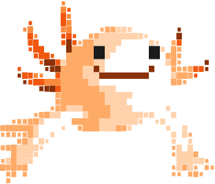
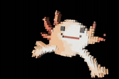

# Source Artwork Skills

Portable, provider-agnostic agent skills for inspecting real artwork and recreating its 2D animation and 3D form faithfully.

## Skills

- **[Source Artwork 2D/3D Reconstruction](skills/source-artwork-2d-3d-reconstruction/SKILL.md)** — unified workflow; use this for end-to-end, source-faithful 2D and 3D work.
- [Source Artwork 2D Animation](skills/source-artwork-2d-animation/SKILL.md) — focused pixel-art, SVG, sprite-frame, and playback workflow.
- [Source Artwork 3D Animation](skills/source-artwork-3d-animation/SKILL.md) — focused source-derived 3D geometry, rigging, and looping animation workflow.

## Worked example: the axolotl, from source art to 3D motion

<table>
  <tr>
    <th>2D source mark (SVG)</th>
    <th>3D reconstruction (animated)</th>
  </tr>
  <tr>
    <td></td>
    <td>
      <picture>
        <source srcset="examples/axolotl-3d-demo-still.png" media="(prefers-reduced-motion: reduce)">
        
      </picture>
    </td>
  </tr>
</table>

The left is the source's flat 2D artwork; the right is the animated 3D reconstruction built from it. The website's own 2D animation was a separate frame sequence, described below.

1. **Inspect the input.** The mark was a 312 × 266 SVG with seven colored paths made from 253 rectangular pixel-art cells. The website's animation was separate from the static logo.
2. **Trace the original motion.** The inspected site bundle contained 24 frames on a 39 × 28 cell grid, packed as base64 and decoded to SVG at 12 fps. Hover and keyboard focus drove playback. The bundle exposed the playback format, but not the artist's drawing tool.
3. **Preserve the artwork.** The source cells, colors, coordinates, and silhouette were retained instead of redrawing from a screenshot.
4. **Build connected 3D motion.** The 2D cells became shallow colored layers, then were grouped into body, gills, eyes, and limb sections. Pivots follow real attachment points; body sway, breathing, limb strokes, gill motion, and a blink add life without losing the source silhouette.
5. **Render and check.** The result was rendered as a deterministic loop and inspected at key poses for silhouette drift, detached joints, clipping, and the loop seam. The still above is used when reduced motion is preferred.

**Fidelity boundary:** the inspected website animation was 2D. This GIF is a 3D reconstruction derived from its visible source artwork—not an original 3D model recovered from the site. Depth and hidden surfaces are inferred. The MIT license covers the skills and documentation; the axolotl artwork remains with its respective rights holder.


## What “1:1” means here

When the original 2D paths, frames, or model are available, the skills direct the agent to preserve them and verify against matched captures. If only a flat 2D reference exists, hidden 3D depth and surfaces cannot be recovered exactly; the unified skill requires those parts to be identified as inferred rather than presented as the original model.

## Install

Each skill is a self-contained folder containing a standard `SKILL.md` with a name and activation description. Install the folder—not just the Markdown file—into a skills directory supported by your agent. For example, in an environment that loads user skills from `~/.agents/skills/`:

```sh
mkdir -p ~/.agents/skills
cp -R skills/source-artwork-2d-3d-reconstruction ~/.agents/skills/
```

For project-only use, copy it into the project-level skills directory supported by your host. Skill-discovery paths differ between agent products; this repository does not depend on any particular model provider, renderer, editor, or agent runtime.

## License

MIT. See [LICENSE](LICENSE).
